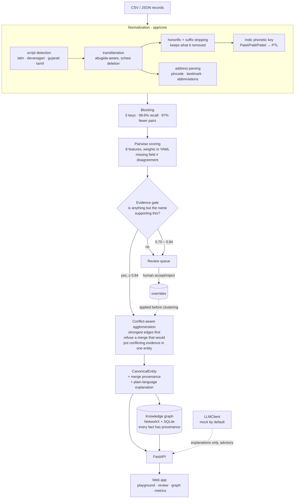

# indic-er

**Entity resolution for messy Indian names, businesses and addresses.**
A proof of value: a working service, a web app, seeded synthetic data, and a
measured comparison against the obvious alternative.

```bash
py tasks.py setup      # install dependencies
py tasks.py demo       # boot API + web app on http://127.0.0.1:8141
```

`make setup` / `make demo` work identically where GNU make exists.

---

## The problem

The same person shows up under many spellings across Indian datasets:

| source | name | address | phone |
|---|---|---|---|
| kyc | Jayeshbhai Patel | 12, Shreeji Soc., Nr. Swaminarayan Mandir, Maninagar, Ahmedabad 380008 | +91 98250 12345 |
| wallet | જયેશ પટેલ | 12 Shriji Society, opp Swaminarayan Temple, Maninagar, Ahmedabad | 9825012345 |
| logistics | J. Patil | Shreeji Society, Maninagar, Amdavad, 380 008 | — |

One person. A fintech doing KYC dedupe, a logistics firm merging delivery
addresses or an e-commerce team building a single customer view needs these
collapsed into one entity — with an auditable reason for the merge.

Plain fuzzy matching fails because the noise is **systematic**, not random:
transliteration choice (Jayesh / Jaishe / Jaysh), honorifics fused into the
name (bhai, ben, ji), legal suffixes (Pvt Ltd, & Sons), Indic address idiom
("Nr.", "opp.", "near ___ mandir"), and surnames so common
(Patel / Shah / Kumar) that name similarity is nearly uninformative.

And the hardest case is the opposite one: **two different people called Jayesh
Patel**, which every Indian dataset contains.

## Results

Measured on 5,000 synthetic records from 1,302 true entities, with ground
truth. Reproduce with `make eval`; full detail in
[docs/eval-report.md](docs/eval-report.md).

| | pairwise P | R | F1 | B³ F1 | entities | largest cluster |
|---|---|---|---|---|---|---|
| **indic-er** | **0.981** | **0.933** | **0.957** | **0.972** | 1,444 | 15 |
| baseline — exact only | 0.220 | 0.112 | 0.148 | 0.472 | 3,158 | 14 |
| baseline — exact + fuzzy | 0.040 | 0.452 | 0.074 | 0.324 | 678 | 170 |
| ground truth | 1.000 | 1.000 | 1.000 | 1.000 | 1,302 | 8 |

**12.9× the fuzzy baseline on pairwise F1**, with 168 false-positive pairs
against the baseline's 101,138.


*The metrics page in the running app. Green is the measured optimum on the
sweep, blue the shipped default.* Blocking recall is 0.9956, so only 41 of 9,424
true pairs are unreachable before scoring even starts.

The baseline is a real implementation, not a strawman: exact match then
Jaro-Winkler on raw name strings, blocked on the first two characters. It
catches a trailing suffix and a plain typo. It cannot see through a leading
honorific, a change of script, or Patel/Patil.

### What each component is worth

| removed | P | R | F1 | ΔF1 |
|---|---|---|---|---|
| nothing (full pipeline) | 0.981 | 0.933 | 0.957 | — |
| evidence gate | 0.461 | 0.895 | 0.608 | −0.349 |
| address evidence | 0.508 | 0.852 | 0.636 | −0.321 |
| transitivity check | 0.688 | 0.941 | 0.795 | −0.162 |
| phone | 0.964 | 0.928 | 0.946 | −0.011 |
| conflict rules | 0.976 | 0.933 | 0.954 | −0.003 |
| name rarity | 0.984 | 0.930 | 0.956 | −0.001 |
| phonetics (scoring only) | 0.996 | 0.929 | **0.961** | **+0.004** |

Four of those rows need saying out loud:

- **The evidence gate and address evidence carry the system.** Remove either
  and precision roughly halves. Everything else is refinement.
- **The transitivity check is what makes precision usable.** A pairwise score
  guarantees nothing about transitivity: A~B and B~C can both pass while A~C
  was compared directly and rejected. Refusing that merge takes precision from
  0.688 to 0.981 — false-positive pairs fall from roughly 4,000 to 168 — for
  under a point of recall.
- **Removing the phonetic scoring feature slightly *improves* F1** (0.961 vs
  0.957; it trades 1.5 points of precision for 0.4 of recall). That is the
  measurement, so it is what the table says. It is kept at a non-zero weight
  because the margin is within noise and the phonetic signal is what holds
  recall up on datasets with sparser address coverage — but on this benchmark
  its scoring contribution is not positive, and pretending otherwise would be
  dishonest. **Its indispensable job is blocking:** remove it there and recall
  falls from **0.996 to 0.814**, putting 1,758 true pairs beyond the reach of
  any threshold. Judging the phonetic key on the scoring ablation alone would
  be the wrong conclusion from the right number.
- **The field-based conflict rules now earn almost nothing** (−0.003). The
  transitivity check subsumes most of what they caught. They are retained
  because they fire on pairs that were never scored, which transitivity by
  design cannot see — but their measured contribution is near zero and is
  reported as such rather than quietly dropped.

## Architecture



```
app/
  core/        matching. no I/O, no network, no LLM dependency
  kg/          ontology, GraphStore, provenance, LLMClient
  api/         FastAPI surface
  evaluation/  metrics, sweep, ablations, report generation
config/        ontology, honorifics, phonetics, addresses, weights — all YAML
data/          generator, seeded synthetic dataset
web/           the app: no build step, no node_modules
docs/          eval report, demo script
```

### Decisions worth knowing about

**The matching core never calls an LLM.** `app/core` does not import
`app/kg/llm.py`, and [a test enforces it](tests/test_kg.py). Matching has to be
reproducible, offline, cheap and defensible to an auditor. The LLM is used
only to rephrase explanations and to offer an advisory second opinion on
borderline pairs, both clearly labelled in the UI.

**A missing field is never a disagreement.** Features return `None` when they
cannot be computed, and `None` features are dropped from *both* sides of the
weighted mean. A record with no phone must not score worse than one with a
*wrong* phone. This is the most common way a scoring model quietly becomes
useless on real data, where a third of fields are blank.

**Names cannot carry a merge alone.** The name features sum to 0.42, below the
0.84 merge threshold. On top of that an **evidence gate** requires that
something outside the name supports the pair — because dropping missing
features renormalises the rest, so a pair whose only comparable fields are the
name scores 1.00 on an identical common name. Those pairs act as bridges: with
the gate off, connected components chained 4,702 records into one "entity".

**Clustering checks conflicts before merging, not after.** Merge edges are
applied strongest-first and an edge is refused if the cluster it would create
would either trip a rule from `config/weights.yaml` (two different pincodes
*and* two different phones, say) or **contain a pair that was scored and
rejected**. Checking before the union means a bad merge never happens and
nothing has to be unpicked.

That second test — the transitivity check — only ever fires on pairs that were
actually scored. A pair blocking never proposed is *unknown*, not disagreement;
treating absence as a veto would turn blocking's 99.6% recall ceiling into a
precision ceiling as well, and would tear apart large true clusters where not
every internal pair happens to be a candidate.

**Every graph fact carries provenance** — source, timestamp, confidence and
method (`rule` / `model` / `human`). The ontology refuses the write otherwise.

## Commands

| command | what it does |
|---|---|
| `py tasks.py demo` | seed and boot API + web app |
| `py tasks.py data` | regenerate the synthetic dataset (seeded, deterministic) |
| `py tasks.py test` | pytest with coverage on `app/core` (fails under 80%) |
| `py tasks.py eval` | full evaluation → `docs/eval-report.md` + `data/eval.json` |
| `py tasks.py lint` / `fmt` | ruff |
| `py tasks.py clean` | remove generated artefacts |

`make <target>` does the same thing wherever GNU make is installed;
`make.bat <target>` works from `cmd.exe`.

## API

| endpoint | purpose |
|---|---|
| `POST /resolve` | batch of records → canonical entities, with stats and the normalization trace |
| `POST /match` | two records → score, decision, per-feature contributions, explanation |
| `GET /entities/{id}` | one entity: members, merge evidence, conflicts, graph, provenance |
| `GET /review-queue` | borderline pairs, ordered by uncertainty |
| `POST /review/{pair_id}` | accept/reject; re-resolves immediately |
| `GET /metrics` | live stats for the seeded data **plus** the ground-truth evaluation |
| `GET /health`, `GET /ontology` | status; ontology as JSON, JSON-LD or Turtle |

Interactive docs at `/docs`. Structured logs, one line per request with a
correlation id (`LOG_JSON=1` for JSON).

## What is real and what is mocked

**Real** — everything in the matching path:

- transliteration, phonetics, honorific/suffix stripping, address parsing
- blocking, scoring, the evidence gate, conflict-aware clustering
- the review queue, its overrides and its threshold analysis (SQLite-backed)
- the knowledge graph with enforced provenance, and JSON-LD / Turtle export
- the evaluation: every number in the report and on the Metrics page comes
  from the run that produced it

**Mocked or simplified, deliberately:**

| | status |
|---|---|
| **Data** | 100% synthetic. No real PII, no scraping. Identifiers are masked by construction and the API **rejects** an unmasked one. |
| **LLM** | `LLM_MODE=mock` by default — deterministic, offline, no API key. `LLM_MODE=live` + `ANTHROPIC_API_KEY` uses Anthropic. Either way it only phrases explanations and gives advisory opinions. |
| **Graph store** | NetworkX + SQLite behind a `GraphStore` interface. Neo4j/Kuzu is one more subclass; `app/core` would not change. |
| **Scale** | single process, in-memory. 5,000 records resolve in ~18s, dominated by scoring 332k candidate pairs. |
| **Auth / multi-tenancy / rate limits** | none. It is a POV. |
| **Transliteration** | rule-based tables for Devanagari, Gujarati and Tamil. Bengali, Kannada, Telugu, Malayalam, Odia, Punjabi and Urdu are not implemented. |

### Two deviations from the brief, and why

**Next.js → dependency-free ES modules.** There is no Node or npm on the
target machine, so Next.js could not be installed or built. The web app is
plain ES modules with vendored Cytoscape and hand-written CSS, served by
FastAPI on one origin — no build step, no `node_modules`, works offline.
Every required screen is delivered (playground with CSV/JSON input and "Why?"
explanations, review queue with keyboard shortcuts, Cytoscape cluster graph,
metrics). Module boundaries mirror an App Router layout (one module per route,
a shared pair component, an api client) so a port is mechanical.

**`make` → `tasks.py`.** No GNU make either. Targets live in `tasks.py`; a
`Makefile` and a `make.bat` both delegate to it, so `make demo` works where
make exists and `py tasks.py demo` always works.

Both are recorded in [PLAN.md](PLAN.md) section 7.

## Next steps to productize

### Data acquisition

The eval measures the pipeline against *our* noise model, which is the honest
limit of a synthetic benchmark. First real step: **a few thousand hand-labelled
pairs from the customer's own records**, stratified by the slices in the eval
report rather than sampled uniformly — the average is not the risk, the worst
slice is. That sample is also the only sound way to tune the weights for their
field completeness, which differs enormously between a KYC file and a
logistics feed.

Second: an **Indian-specific reference layer** the rules can lean on — the
PIN-code directory for locality/pincode validation, a landmark gazetteer per
city, and a name-frequency table (the `common_surnames` list is a hand-written
stand-in for real frequency data). None requires scraping; all are licensable
or open.

### Scale

Today: single process, ~18s for 5,000 records, dominated by scoring. The path
to 100M records needs three changes, in order:

1. **Push blocking into the datastore.** The keys are already plain strings;
   they become indexed columns. Candidate generation becomes a join, not a
   Python loop.
2. **Parallelise scoring.** Pairs are independent and the features are pure
   functions of two records — embarrassingly parallel across processes or a
   Spark/Ray job.
3. **Incremental resolution.** Re-resolving everything on each new record is
   the wrong shape for production. The union-find structure already supports
   adding a record and merging only the affected clusters; what is missing is
   persistence of cluster state and an entity-id stability guarantee across
   runs (ids are currently derived from the member set, so they change when a
   cluster changes — fine for a POV, not for downstream consumers).

Streaming/online matching, then blocking on learned embeddings, are the
next-but-one steps — and only once labelled data exists to show they beat the
rules.

### Compliance (DPDP Act 2023)

Entity resolution is, by construction, linking personal data across sources —
exactly what a data-protection regime scrutinises. What this POV already does
right, and what production would add:

- **Data minimisation.** indic-er never stores a full identifier; the API
  rejects an unmasked one. Keep that.
- **Purpose limitation.** A resolved identity built for KYC is not
  automatically usable for marketing. Production needs purpose tags on source
  records and purpose-scoped resolution.
- **Right to erasure and correction.** Provenance on every fact makes this
  tractable — a record can be removed and its clusters recomputed. Needs a
  tested delete path and a demonstrable audit trail.
- **Explainability for the data principal.** The per-feature explanation is
  already the raw material for "why do you think these are the same person?"
- **Consent and cross-border.** Where the data lives and which consents cover
  linkage are customer-side decisions; the system should record them, not
  assume them.
- **Significant Data Fiduciary obligations** (DPIA, audits) are likely to apply
  to a fintech deploying this at scale — worth raising before procurement, not
  after.

Not legal advice; these are the questions to put to the customer's counsel.

### Pricing hypothesis

Two defensible models, and the trade is between them:

- **Per-record resolved, tiered** — roughly ₹0.08–0.25 per record per month for
  a continuously maintained resolved set, falling with volume. Fits a
  single-customer-view use case where the whole base is re-resolved and the
  value is the maintained graph. Predictable for the buyer; aligns our revenue
  with their data growth rather than their activity.
- **Per API call** — roughly ₹0.50–2.00 per `/match` or per small `/resolve`
  batch. Fits transactional KYC, where a decision is made at onboarding.
  Higher unit price because each call sits on the critical path of a
  regulated decision.

Most customers need both, so: a platform fee covering the maintained entity
graph, plus metered real-time calls. The review queue is the natural upsell —
a managed-review tier where we staff the borderline band to a target precision,
priced per decision.

**What to validate first:** that customers will pay for *precision* rather than
volume. The headline number that sells this is not F1 — it is "how many false
merges per 100,000 records, and what does one cost you?" That number is
customer-specific and needs their labelled data, which is why the labelling
exercise above is step one commercially as well as technically.

## Testing

```bash
py tasks.py test
```

374 tests. Coverage on `app/core` is **97%** against an enforced floor of 80%.
Includes API contract tests, a web smoke test, and a test asserting that the
matching core never imports the LLM layer.

## Licence and data

Synthetic data only. Names are common Indian given names and surnames used as a
word list; pincodes are real sorting codes; house numbers, societies, phone
numbers and every combination are invented. No real person or business is
represented.
